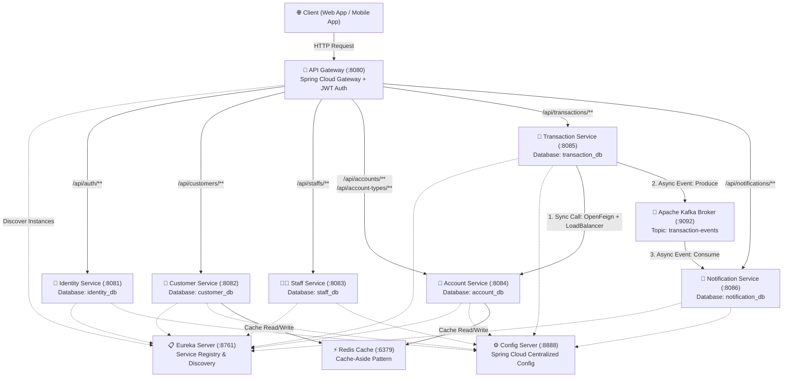
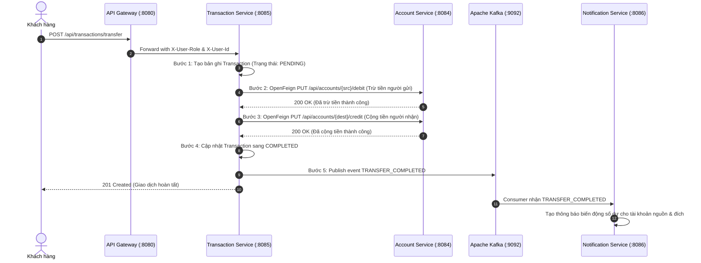
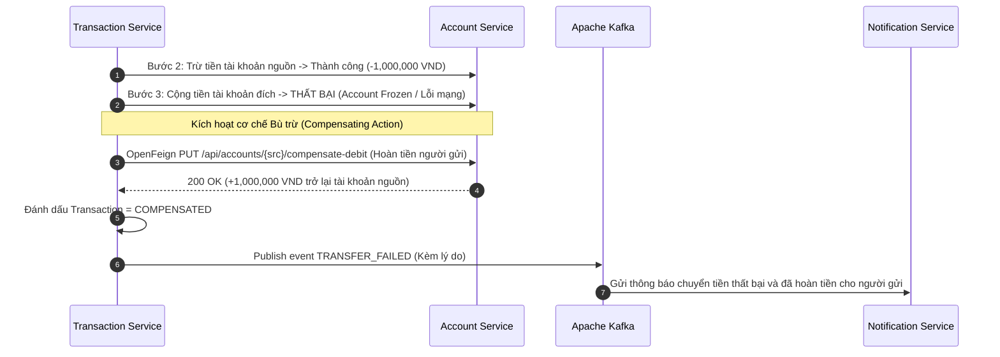
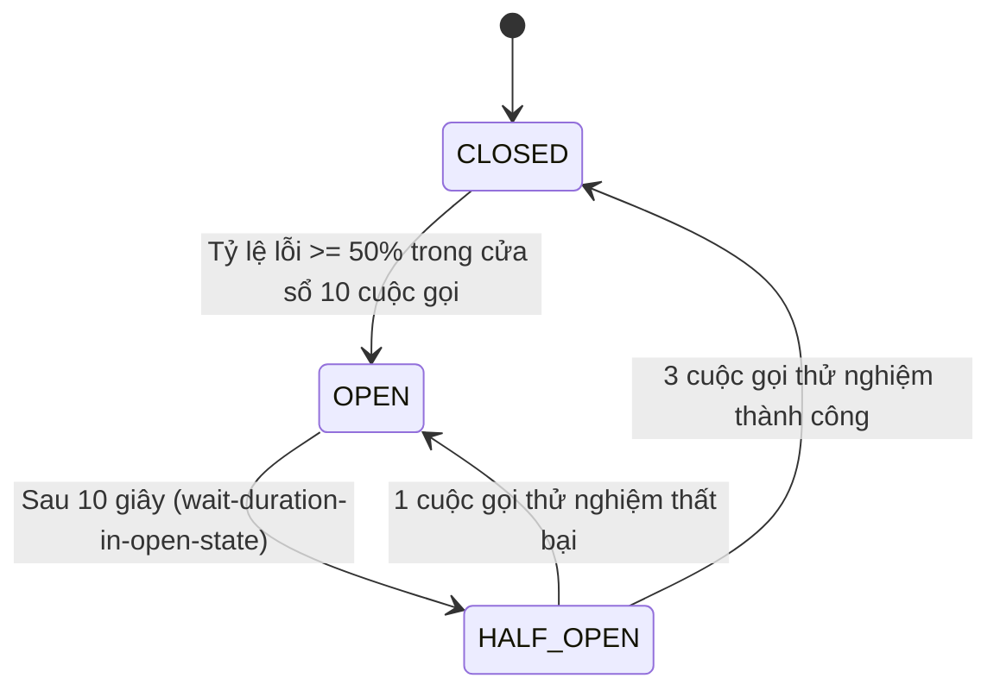

# 🏦 RikkeiBank - Hệ Thống Ngân Hàng Số Phân Tán (Microservices Architecture)

Dự án chuyển đổi hệ thống ngân hàng từ kiến trúc Monolithic tập trung sang kiến trúc **Microservices (MSA)** phân tán, độc lập và có khả năng mở rộng cao, phục vụ làm nền tảng Backend API cho Web App và Mobile App.

---

## 📑 Bảng Mục Lục
1. [Lý do lựa chọn kiến trúc Microservices (MSA)](#1-lý-do-lựa-chọn-kiến-trúc-microservices-msa)
2. [Kiến trúc Tổng thể Hệ thống](#2-kiến-trúc-tổng-thể-hệ-thống)
3. [Chi tiết từng Microservice & Database-per-Service](#3-chi-tiết-từng-microservice--database-per-service)
4. [Giao tiếp Đồng bộ & Bất đồng bộ](#4-giao-tiếp-đồng-bộ--bất-đồng-bộ)
5. [Giao dịch Phân tán: Saga Pattern (Orchestrator & Rollback)](#5-giao-dịch-phân-tán-saga-pattern)
6. [Kháng lỗi Cascading Failure với Circuit Breaker (Resilience4j)](#6-kháng-lỗi-cascading-failure-với-circuit-breaker)
7. [Bộ nhớ đệm phân tán Redis (Cache-Aside Strategy)](#7-bộ-nhớ-đệm-phân-tán-redis-cache-aside-strategy)
8. [Bảo mật, Phân quyền & Quản lý Phiên Người dùng (JWT)](#8-bảo-mật-phân-quyền--quản-lý-phiên-người-dùng-jwt)
9. [Kiểm soát Lỗi tập trung (Centralized Exception Handling)](#9-kiểm-soát-lỗi-tập-trung-centralized-exception-handling)
10. [Hướng dẫn Khởi chạy Hệ thống & Kiểm thử (Postman & Jacoco)](#10-hướng-dẫn-khởi-chạy-hệ-thống--kiểm-thử)

---

## 1. Lý do lựa chọn kiến trúc Microservices (MSA)

| Tiêu chí | Hệ thống Monolithic cũ | Hệ thống Microservices (RikkeiBank MSA) |
|---|---|---|
| **Khả năng mở rộng (Scalability)** | Phải scale toàn bộ ứng dụng cồng kềnh | Scale độc lập service có tải cao (ví dụ `transaction-service`, `account-service`) |
| **Độ tin cậy & Cô lập lỗi (Fault Isolation)** | 1 module lỗi (vd: gửi mail/SMS treo) có thể làm sập toàn bộ hệ thống | Lỗi ở `notification-service` không ảnh hưởng luồng chuyển khoản; Circuit Breaker ngăn lỗi lan truyền (Cascading Failure) |
| **Bảo trì & Phát triển (Maintainability)** | Codebase khổng lồ, dễ xung đột, deploy rủi ro | Codebase nhỏ gọn theo Domain-Driven Design (DDD), CI/CD độc lập cho từng nhóm |
| **Dữ liệu tài chính** | Dùng chung 1 database lớn, nguy cơ deadlock và phụ thuộc chặt | Mô hình **Database-per-Service**, mỗi service sở hữu DB riêng biệt, bảo vệ toàn vẹn dữ liệu |

---

## 2. Kiến trúc Tổng thể Hệ thống



---

## 3. Chi tiết từng Microservice & Database-per-Service

Hệ thống tuân thủ nghiêm ngặt nguyên tắc **Database-per-Service**: Không một service nào được phép truy cập trực tiếp DB của service khác. Mọi trao đổi dữ liệu phải thông qua REST API hoặc Kafka Event.

| Service | Port | Database riêng | Chức năng chính |
|---|---|---|---|
| **Config Server** | `8888` | - | Quản lý tập trung toàn bộ file cấu hình `.yml` cho tất cả microservice |
| **Eureka Server** | `8761` | - | Service Discovery, theo dõi tình trạng sống còn (heartbeat) của các instance |
| **API Gateway** | `8080` | - | Điểm đón request duy nhất, xác thực JWT, định tuyến (Routing), gắn Header danh tính |
| **Identity Service** | `8081` | `identity_db` | Đăng ký, đăng nhập, cấp JWT (Access + Refresh Token), phân quyền vai trò, Admin thu hồi quyền truy cập |
| **Customer Service** | `8082` | `customer_db` | Quản lý hồ sơ khách hàng (CCCD, địa chỉ, ngày sinh, SĐT). Có Redis cache |
| **Staff Service** | `8083` | `staff_db` | Quản lý hồ sơ nhân viên ngân hàng/giao dịch viên (TELLER, MANAGER) |
| **Account Service** | `8084` | `account_db` | Quản lý Danh mục loại tài khoản và tài khoản thanh toán; thực hiện Debit, Credit, Compensate Debit |
| **Transaction Service** | `8085` | `transaction_db` | Điều phối Saga Chuyển khoản, ghi vết giao dịch, phát sự kiện Kafka, Circuit Breaker bảo vệ |
| **Notification Service** | `8086` | `notification_db` | Consumer Kafka nhận sự kiện giao dịch, gửi thông báo biến động số dư và ghi nhận trạng thái đã đọc |

---

## 4. Giao tiếp Đồng bộ & Bất đồng bộ

### 4.1. Giao tiếp Đồng bộ (Synchronous Communication)
- **Công nghệ**: **Spring Cloud OpenFeign** kết hợp **Spring Cloud LoadBalancer**.
- **Cách thức hoạt động**: `transaction-service` không gọi cứng địa chỉ IP/Port của `account-service`, mà gọi qua tên định danh đăng ký trên Eureka: `@FeignClient(name = "account-service")`. LoadBalancer sẽ tự động phân phối tải giữa các instance của `account-service`.
- **Ứng dụng**: Các bước trừ tiền (Debit) và cộng tiền (Credit) trong luồng Saga chuyển khoản.

### 4.2. Giao tiếp Bất đồng bộ (Asynchronous & Event-driven Architecture)
- **Công nghệ**: **Apache Kafka** (Brokers, Topics, Producers, Consumers).
- **Topic**: `transaction-events` (Partitioned, Reliable).
- **Cách thức hoạt động**:
  1. Sau khi `transaction-service` xử lý xong chuyển khoản, nó phát hành (publish) sự kiện `TransactionEvent` chứa thông tin người gửi, người nhận, số tiền, trạng thái (`TRANSFER_COMPLETED` hoặc `TRANSFER_FAILED`).
  2. `transaction-service` lập tức phản hồi về cho khách hàng (non-blocking).
  3. `notification-service` lắng nghe (subscribe) topic qua `@KafkaListener` và tạo bản ghi thông báo biến động số dư cho cả người gửi và người nhận.
  4. **Ưu điểm**: Loose Coupling (giảm phụ thuộc), hệ thống chịu tải cao, nếu `notification-service` tạm thời chậm hoặc bảo trì thì tin nhắn vẫn lưu trong Kafka và được xử lý lại khi service online trở lại.

---

## 5. Giao dịch Phân tán: Saga Pattern

Trong môi trường Microservices với Database riêng rẽ, không thể dùng `@Transactional` ACID truyền thống xuyên suốt 2 service (`transaction-service` và `account-service`). Hệ thống áp dụng **Saga Orchestrator Pattern**:

### 5.1. Kịch bản Thành công (Happy Path)


### 5.2. Kịch bản Thất bại & Bù trừ (Compensating Rollback Flow)
Khi Bước 2 (Trừ tiền tài khoản nguồn) thành công, nhưng Bước 3 (Cộng tiền tài khoản đích) thất bại (do tài khoản đích bị đóng/đóng băng hoặc sự cố mạng):


---

## 6. Kháng lỗi Cascading Failure với Circuit Breaker

Sử dụng **Resilience4j Circuit Breaker** trên `transaction-service` khi gọi sang `account-service`.



- **CLOSED**: Trạng thái bình thường, mọi request chuyển khoản được gửi đến `account-service`.
- **OPEN**: Khi `account-service` gặp sự cố (down/lag), tỷ lệ lỗi vượt ngưỡng 50%, Circuit Breaker ngắt mạch ngay lập tức. Mọi request chuyển khoản tiếp theo được chuyển sang hàm **fallback**: `transferFallback()`, phản hồi lỗi nhanh chóng mà không làm nghẽn luồng xử lý (ngăn chặn sập dây chuyền).
- **HALF_OPEN**: Sau 10 giây, Circuit Breaker cho phép 3 request thăm dò. Nếu thành công, mạch đóng lại bình thường (CLOSED); nếu vẫn lỗi, mạch tiếp tục mở (OPEN).

---

## 7. Bộ nhớ đệm phân tán Redis (Cache-Aside Strategy)

Tích hợp **Spring Cache + Redis** trong `customer-service` và `account-service`:
- `@Cacheable(value = "customers", key = "#id")`: Khi truy vấn thông tin khách hàng, kiểm tra Redis cache trước. Nếu có (Cache Hit), trả về tức thì không cần query DB; nếu không có (Cache Miss), query DB rồi nạp vào cache.
- `@CachePut(value = "customers", key = "#id")`: Cập nhật thông tin trong DB đồng thời cập nhật cache.
- `@CacheEvict(value = "customers", key = "#id")`: Xóa cache tương ứng khi xóa khách hàng.
- Trong `account-service`, khi số dư thay đổi do Debit/Credit, `@CacheEvict(value = "accounts", allEntries = true)` được gọi để vô hiệu hóa cache cũ, đảm bảo dữ liệu số dư không bao giờ bị sai lệch.

---

## 8. Bảo mật, Phân quyền & Quản lý Phiên Người dùng (JWT)

### 8.1. Ma trận Phân quyền Vai trò (RBAC)

| Vai trò | Phân quyền truy cập |
|---|---|
| **ADMIN** | Toàn quyền quản trị hệ thống: Thêm/Sửa/Xóa Khách hàng, Nhân viên, Loại tài khoản, Tài khoản, xem toàn bộ giao dịch, ép buộc đăng xuất tài khoản bất kỳ (`/api/auth/revoke/{userId}`). |
| **TELLER** (Giao dịch viên) | Chỉ được xem và xử lý các giao dịch do chính mình thực hiện trong ngày (`/api/transactions/today`). Tuyệt đối không can thiệp vào giao dịch của giao dịch viên khác. |
| **CUSTOMER** (Khách hàng) | Chỉ được xem tài khoản và lịch sử giao dịch của chính mình (`/api/transactions/account/{accNo}`), thực hiện chuyển khoản. |
| **Khách vãng lai** | Chỉ được truy cập `/api/auth/login`, `/api/auth/register`, `/api/auth/refresh`. Mọi endpoint tài chính khác bị chặn với mã **401 Unauthorized**. |

### 8.2. Trải nghiệm Phiên Đăng nhập Liền mạch (Seamless Session)
- **Access Token**: Thời hạn ngắn (15 phút), dùng để truy cập tài nguyên.
- **Refresh Token**: Thời hạn dài (7 ngày cho Khách hàng), dùng để xin cấp Access Token mới qua `/api/auth/refresh` mà người dùng không cần phải nhập lại mật khẩu khi mở app.
- **Thu hồi quyền truy cập (Admin Revocation)**: Admin có thể gọi `/api/auth/revoke/{userId}` để vô hiệu hóa tài khoản ngay lập tức khi phát hiện rủi ro bảo mật.

---

## 9. Kiểm soát Lỗi tập trung (Centralized Exception Handling)

Tất cả các service đều cài đặt `@RestControllerAdvice` để chuẩn hóa định dạng lỗi trả về theo chuẩn RESTful:
```json
{
  "timestamp": "2026-09-27T22:30:00.123456",
  "status": 403,
  "error": "Forbidden",
  "message": "Access denied. Required role: ADMIN"
}
```
Các mã lỗi HTTP chuẩn xác:
- `200 OK`: Truy vấn / cập nhật thành công.
- `201 Created`: Tạo mới thành công (Customer, Account, Transaction...).
- `400 Bad Request`: Dữ liệu đầu vào sai định dạng, số dư không đủ.
- `401 Unauthorized`: Chưa đăng nhập hoặc token sai/hết hạn.
- `403 Forbidden`: Truy cập trái thẩm quyền (ví dụ CUSTOMER gọi API của ADMIN).
- `404 Not Found`: Không tìm thấy tài nguyên (tài khoản, khách hàng).
- `500 Internal Server Error`: Lỗi hệ thống nội bộ.

---

## 10. Hướng dẫn Khởi chạy Hệ thống & Kiểm thử

### 10.1. Yêu cầu Môi trường
- Java JDK 17 (hoặc 21)
- Gradle 8.x / 9.x (đã tích hợp Gradle Wrapper `gradlew`)
- Docker & Docker Compose (cho Kafka & Redis)

### 10.2. Khởi chạy Hạ tầng (Kafka, Zookeeper, Redis)
```bash
# Tại thư mục gốc session18
docker-compose up -d
```
Kiểm tra Kafka chạy tại `localhost:9092` và Redis tại `localhost:6379`.

### 10.3. Thứ tự Khởi chạy Microservices
Khởi chạy lần lượt các service theo thứ tự phụ thuộc:
1. **Config Server** (Port `8888`): `./gradlew :config-server:bootRun`
2. **Eureka Server** (Port `8761`): `./gradlew :eureka-server:bootRun`
   - Truy cập Eureka Dashboard tại: `http://localhost:8761`
3. **API Gateway** (Port `8080`): `./gradlew :api-gateway:bootRun`
4. **Identity Service** (Port `8081`): `./gradlew :identity-service:bootRun`
5. **Customer Service** (Port `8082`): `./gradlew :customer-service:bootRun`
6. **Staff Service** (Port `8083`): `./gradlew :staff-service:bootRun`
7. **Account Service** (Port `8084`): `./gradlew :account-service:bootRun`
8. **Transaction Service** (Port `8085`): `./gradlew :transaction-service:bootRun`
9. **Notification Service** (Port `8086`): `./gradlew :notification-service:bootRun`

### 10.4. Kiểm thử Tự động với JaCoCo
Chạy toàn bộ Unit Tests và sinh báo cáo độ bao phủ mã nguồn (Code Coverage):
```bash
./gradlew test
```
Báo cáo JaCoCo HTML được sinh tại thư mục: `<service-name>/build/reports/jacoco/test/html/index.html`.

### 10.5. Kiểm thử với Postman Collection
Import file [RikkeiBank_Microservices.postman_collection.json](file:///e:/[IT-214]_Microservices_System_Design/btvn/session18/RikkeiBank_Microservices.postman_collection.json) vào Postman:
1. Chạy các request trong folder **01. Identity & Auth Service** để lấy token `admin_token`, `teller_token`, `customer_token`. Biến môi trường sẽ tự động được lưu.
2. Chạy folder **02, 03, 04** để tạo khách hàng, nhân viên, loại tài khoản, tài khoản và nạp số dư ban đầu.
3. Chạy folder **05. Transaction & Saga Orchestrator** để kiểm chứng luồng chuyển khoản thành công và luồng rollback bù trừ khi lỗi.
4. Chạy folder **06. Notification Service** để kiểm tra thông báo biến động số dư nhận từ Kafka.
5. Chạy folder **07. Infrastructure** để xem trạng thái Eureka, Config Server và Circuit Breaker.
